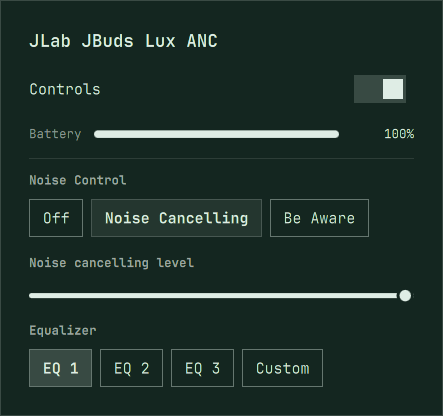

# Omarchy Buds

Battery, noise control and settings for Bluetooth earbuds and headphones, right in the
[Omarchy](https://omarchy.org/) bar, built on [BudsLink](https://github.com/maniacx/BudsLink)'s
device support (AirPods, Galaxy Buds, Sony, Nothing, Pixel Buds, Redmi, Realme/Oppo/OnePlus, Bose,
Sennheiser, Soundcore and more).



This repository is a fork of BudsLink. It adds the Omarchy plugin ([`omarchy/`](../omarchy) and
[`manifest.json`](../manifest.json)) and support for more devices. **Full plugin documentation:
[omarchy/README.md](../omarchy/README.md)**: features, requirements, what it does on your system,
settings, keybindings, troubleshooting and development.

## Install

Review the code first: plugins run unsandboxed inside the shell. Then:

```bash
omarchy plugin add https://github.com/kshatriya-abhay/BudsLink --enable
```

Requires `gjs` (installed on stock Omarchy) and BlueZ, with your earbuds paired as usual.
Updates: `omarchy plugin update kshatriya-abhay.buds`.

## Remove

```bash
omarchy plugin remove kshatriya-abhay.buds
rm -rf ~/.local/state/omarchy-buds    # settings, logs and snapshots, for a clean removal
```

The earbuds keep whatever settings they had.

## Devices this fork adds

Tested on hardware, on top of everything BudsLink supports:

| Device | Status |
|---|---|
| realme Buds Air 8 | Battery, noise control and levels, wind noise, EQ (presets and custom), switches |
| realme Buds Wireless 3 | Battery, noise control, EQ presets, game mode, spatial audio, dynamic bass and its level |
| JLab JBuds Lux ANC | Battery, noise control (Off / Noise Cancelling / Be Aware) and level, EQ presets (new device family: Jieli RCSP) |

These are being proposed upstream to BudsLink.

## License

GPL-3.0-or-later, like BudsLink: see [LICENSE](../LICENSE). The repository also carries BudsLink's
bundled copy of libgnome-volume-control (`subprojects/gvc`, GPL-2.0-or-later), which only BudsLink's
Flatpak build uses; the plugin doesn't load it. Not affiliated with any earbud maker, BudsLink or
Omarchy.
